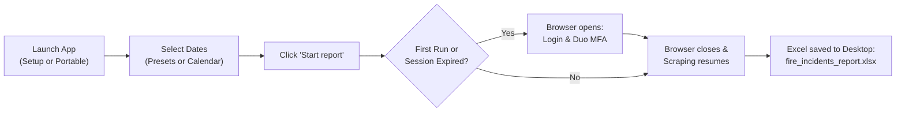

# ESO Suite Fire Incidents Report Generator
**Lyn-Dan Heights Volunteer Fire Department**

An automated reporting tool for fire and rescue services to compile incident response records from [ESO Suite Records Management System (RMS)](https://www.esosuite.net/fireincidents/records/search) into clean, plain-text Excel workbooks (`.xlsx`) saved directly to your Desktop.

Built specifically for Windows 10 & 11 with zero technical setup required for end users: self-healing session persistence, Duo/SMS MFA authentication, high-speed API record extraction, and a dark-mode graphical desktop application.

---

## Consumer Quickstart: Getting Started in 30 Seconds

Choose the option that fits how you want to run the program. **No Python installation is required** for Options 1 and 2.

### Option 1: Setup Installer Wizard (Recommended)
Best for primary department desktop computers and laptops:
1. Run [`dist/eso-reports-setup.exe`](dist/eso-reports-setup.exe).
2. Follow the standard setup wizard (no administrator password needed; installs to `%LOCALAPPDATA%\Programs\ESO Reports`).
3. An **ESO Reports** shortcut will appear on your Desktop and in your Start Menu.
4. Includes a clean Windows uninstaller in *Settings > Apps > Installed apps*.

### Option 2: Portable Executable (No Install Required)
Best for flash drives, shared network drives, or running without installing:
1. Copy or launch [`dist/eso-reports-portable.exe`](dist/eso-reports-portable.exe).
2. Double-click the file to open the app immediately anywhere on your computer.

### Option 3: One-Click Run Script (From Source)
If you have cloned or downloaded the repository:
1. Double-click [`run.bat`](run.bat) in the folder.
2. The launcher will automatically find the local executable or Python runtime and start the application.

---

## Step-by-Step Usage Guide



### 1. Select the Date Range
- Click **This Month** or **Last Month** for instant one-click selection.
- Or click **Start Date** and **End Date** to choose specific dates using the popup calendar.

### 2. Click "Start report"
- Click the blue **Start report** button.
- The indicator will switch to orange `In progress...`.

### 3. First-Time Authentication & MFA
- On your first run (or if your previous session has expired), an automated browser window will open.
- Enter your **Agency ID**, **Username**, and **Password**, then approve any **Duo Push**, phone call, or SMS code.
- As soon as you reach the ESO Records search page, **the browser window will automatically close and save your session**.
- Your credentials remain securely stored in `%APPDATA%\eso-reports\session.json`. You will not have to log in again until ESO invalidates your session.

### 4. Open Your Report
- When finished, the app will display a green `Done` checkmark.
- The finalized Excel spreadsheet is saved directly to your **Desktop** as `fire_incidents_report.xlsx` (fully compatible with OneDrive Desktop syncing).

---

## Report Structure (`.xlsx`)

The generated spreadsheet is plain-text formatted (no colored fills or distracting styles), with auto-fitted column widths and frozen panes for easy scrolling:

### Sheet 1: `Attendance Matrix`
A master cross-tabulation table linking incidents to responding personnel:
- **Header (Row 1)**: `Incident Number`, `Incident Type`, `Date`, followed by responding personnel sorted alphabetically (`Last, First`).
- **Incident Rows**:
  - `Column A`: CAD Incident Number (e.g., `CO15202600443`).
  - `Column B`: Official Primary Incident Type (e.g., `Motor vehicle collision with injuries`).
  - `Column C`: Dispatch timestamp (`MM/DD/YYYY HH:MM`).
  - `Columns D+`: Responders marked with `"X"`, missed calls left blank.
- **Summary Row (Bottom)**:
  - `Column A`: `Total Calls Made`
  - `Column B`: `Total Incidents: M`
  - `Columns D+`: Individual call counts and attendance ratios: `n/M (n%)` (e.g., `12/35 (34.3%)`).
- **Frozen Panes**: Columns A–C and Row 1 are frozen (`D2` freeze pane) so incident numbers and names remain visible while scrolling.

### Sheet 2: `Incident Types & Apparatus`
A structured distribution breakdown:
- **Section 1: Incident Types Breakdown**: Response frequencies and percentage of total calls per incident category.
- **Section 2: Apparatus / Resource Breakdown**: Total dispatches and utilization percentages by apparatus (`Engine 15`, `Rescue 15`, `POV`, `Station Standby`, etc.).
- **Section 3: Other / Inactive Reports Audit Log**: Segregates canceled, draft, or unsubmitted calls so they do not distort active call attendance statistics.

---

## Building the Executables (`build.bat`)

Both the **Setup Installer** and the **Portable Executable** can be compiled with a single click on any Windows computer with Python and Inno Setup:

```cmd
build.bat
```

Or via Python:
```powershell
python scripts/build_installer.py
```

### What the build produces:
| Deliverable | Location | Description |
| :--- | :--- | :--- |
| **Setup Wizard** | `dist/eso-reports-setup.exe` (~59 MB) | Windows installer with desktop shortcut and uninstaller |
| **Portable Executable** | `dist/eso-reports-portable.exe` (~85 MB) | Single-file portable executable (no install required) |
| **Standalone Directory** | `dist/eso-reports/` | Unpacked application folder with binaries and assets |

- Uses built-in Microsoft Edge / Google Chrome for browser automation (no heavy external browser downloads needed).
- Embeds high-resolution application icons and SVG assets.
- Automatically locates Python 3.10–3.13 in standard locations, virtual environments, or `PATH`.

---

## Frequently Asked Questions & Troubleshooting

<details>
<summary><b>Windows Defender / SmartScreen says "Windows protected your PC"?</b></summary>

Because newly compiled custom software does not yet have an expensive commercial code-signing certificate, Windows SmartScreen may show a warning:
1. Click **More info**.
2. Click **Run anyway**.
The application is 100% open-source and safe.
</details>

<details>
<summary><b>Do I need to install Google Chrome or Python?</b></summary>

No! Both the setup installer and the portable executable are completely self-contained. They connect automatically to Microsoft Edge (which is already built into Windows 10 and 11) or Chrome if installed.
</details>

<details>
<summary><b>Where are my credentials and session stored?</b></summary>

Your authenticated session token is stored exclusively on your local computer in:
`%APPDATA%\eso-reports\session.json` (e.g., `C:\Users\<YourUser>\AppData\Roaming\eso-reports\session.json`).
It is never transmitted to any third-party server.
</details>

<details>
<summary><b>My Desktop uses Microsoft OneDrive. Will the file save correctly?</b></summary>

Yes. The application queries the Windows Shell Folders registry and detects active OneDrive desktop redirection (e.g., `C:\Users\<User>\OneDrive\Desktop`). The report will always land right on your visible Desktop.
</details>

---

## Developer Guide

### Setup Local Environment
```powershell
python -m venv .venv
.\.venv\Scripts\Activate.ps1
python -m pip install --upgrade pip
python -m pip install -e ".[dev]"
```

### Run Unit Tests
```powershell
pytest -v
```
All 44 unit tests verify Windows path discovery, OneDrive detection, browser detection, Pydantic schemas, aggregator mathematics, Excel formatting, and PyQt6 GUI components.

---

## Project Structure

```
eso-reports-generator/
├── .github/
│   └── workflows/
│       └── test.yml           # Automated Windows CI test workflow
├── assets/
│   ├── app_icon.ico           # Multi-resolution Windows application icon
│   ├── check.svg              # Vector completion checkmark
│   └── ldhvfd_logo.png        # Lyn-Dan Heights VFD department crest
├── dist/                      # Compiled Windows distributions
│   ├── eso-reports-setup.exe  # Setup wizard installer
│   ├── eso-reports-portable.exe # Standalone portable single executable
│   └── eso-reports/           # Unpacked binary directory
├── installer/
│   ├── entrypoint.py          # PyInstaller bootstrap entrypoint
│   ├── eso-reports.spec       # PyInstaller dual onedir & portable spec
│   └── installer.iss          # Inno Setup Windows installer script
├── scripts/
│   ├── build_installer.py     # Automated dual-build & packaging script
│   └── make_icon.py           # Multi-resolution ICO generator
├── src/
│   └── eso_reports/
│       ├── __init__.py        # Package exports & metadata
│       ├── aggregator.py      # Attendance and frequency metric compiler
│       ├── auth.py            # Windows Edge/Chrome launcher & MFA session manager
│       ├── cli.py             # CLI application entrypoint
│       ├── config.py          # Windows %APPDATA% and Desktop path configuration
│       ├── excel_exporter.py  # Plain-text OpenPyXL spreadsheet generator
│       ├── gui.py             # PyQt6 dark-mode desktop GUI
│       ├── models.py          # Incident schemas & name normalization
│       └── scraper.py         # Playwright & REST API extraction engine
├── tests/
│   ├── test_aggregator.py     # Aggregator and attendance roster tests
│   ├── test_auth.py           # SessionManager and authentication tests
│   ├── test_cli.py            # CLI entrypoint tests
│   ├── test_excel_exporter.py # Excel formatting and sheet layout tests
│   ├── test_gui.py            # PyQt6 GUI and calendar tests
│   ├── test_scraper.py        # Scraping and date parsing tests
│   └── test_windows.py        # Windows path resolution & browser tests
├── build.bat                  # One-click Windows build script
├── run.bat                    # One-click Windows application launcher
├── pyproject.toml             # Modern PEP 621 package metadata (Windows)
├── requirements.txt           # Core runtime dependencies
├── requirements-dev.txt       # Development and test dependencies
└── README.md                  # Project documentation
```

---

## License & Department Notice

Configured for Lyn-Dan Heights Volunteer Fire Department incident reporting. Ensure ESO Suite credentials and session tokens are protected in compliance with departmental security guidelines.
